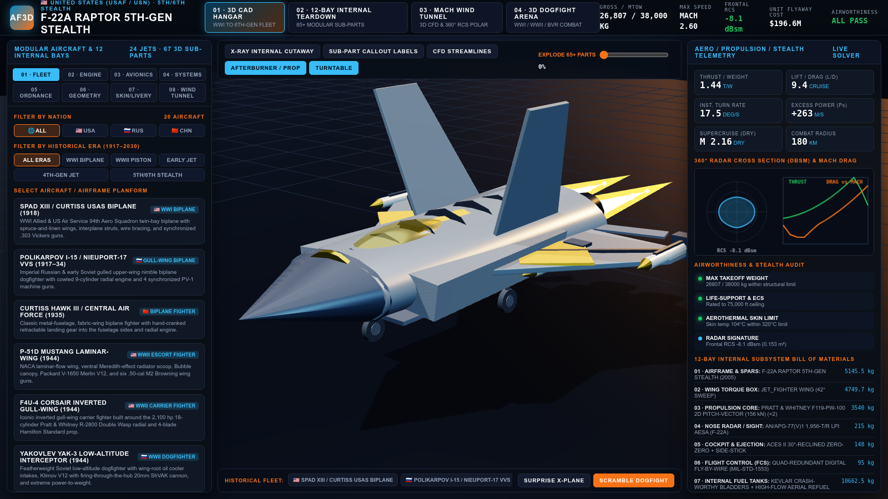

# AeroForge 3D — Supersonic Fighter Jet & Drone CAD, 3D Wind-Tunnel CFD & Dogfight Simulator



**AeroForge 3D** is an interactive 3D aerospace engineering workbench, supersonic Mach wind-tunnel CFD visualizer, multi-stage turbine teardown inspector, and playable 3D BVR/WVR air-combat simulator.

## Key Capabilities

1. **8 Aircraft & UAV Weight Classes & 14 Modular Airframe Planforms (`static/af_physics.js`):**
   - From **Group-3 Tactical UAVs** and **Loyal Wingman UCAVs** (`MQ-28V Ghost Bat`) to **5th-Gen Stealth Fighters** (`F-22X Valkyrie`, `SU-57M Super Flanker`, `F-35B STOVL`), **6th-Gen Tailless Air Dominance** (`FX-60 Wraith`), **Forward-Swept Experimental Dogfighters** (`X-47FS Switchblade`), **Stealth Flying-Wing Bombers** (`B-21R Shadow Raider`), and **Mach 5+ Hypersonic Waveriders** (`SR-72 Darkstar`).
   - Parametric scaling for wingspan, fuselage length, leading-edge sweep angle, and internal fuel fraction.
2. **10 Propulsion & Turbine Architectures + Sub-Part Exploded Teardown (`static/af_models.js`):**
   - Low-bypass 2D/3D thrust-vectoring turbofans (`PW-F119`, `PW-F135`, `EJ230`), 3-stream adaptive cycle engines (`XA100`), dual-mode turbo-ramjets/scramjets (`TBCC`), shaft-driven STOVL lift fans, and cryo-precooled hydrogen engines (`SABRE-Lite`).
   - **Piece-Level Exploded Teardown:** Drag the Teardown slider (`0% -> 100%`) to separate the nose radome, 1,800-element GaN AESA radar array, ITO gold-vapor canopy, HUD combiner, ejection seat, titanium structural bulkheads, rotating compressor fan stages, high-pressure combustor core, thrust-vectoring nozzles, and ordnance racks.
3. **20 Modular Ordnance, Directed-Energy & Avionics Payloads Across 5 Stations:**
   - Centerline Internal Weapon Bay, Left/Right Inboard Pylons, and Left/Right Wingtip Rails supporting `AIM-260 JATM`, `AIM-120D AMRAAM`, `MBDA Meteor`, `AIM-9X Block III`, `IRIS-T`, `M61A2 20mm Vulcan`, `150kW Solid-State Laser Pod`, `CHAMP Microwave EMP`, `AGM-158C LRASM`, `HAWC Mach-6 Scramjet`, and `ALQ-249 GaN Jammer`.
4. **First-Principles Mach Wind-Tunnel CFD & 360° Radar Cross Section (RCS dBsm) Solver:**
   - Real International Standard Atmosphere (ISA `0–70,000 ft`), Prandtl-Glauert compressibility, transonic/supersonic wave drag, Mach shock cone (`sin μ = 1/M`), 3D streamline vortex ribbons, Specific Excess Power ($P_s$), instantaneous/sustained turn rates, aerothermal skin stagnation temperature, and a live 360° RCS polar rose.
5. **Playable 3D Supersonic Dogfight & BVR Combat Simulator (`static/af_dogfight.js`):**
   - Fly your custom aircraft in a 3D airspace with a holographic green Fighter HUD, or toggle **AI Wingman Override** to watch autonomous dogfights.
   - Controls: `W / S` Pitch · `A / D` Roll & Turn · `SPACE` 20mm Autocannon · `SPACE + ArrowUp` Fox-3 BVR Missile (`AIM-260 JATM`) · `SPACE + ArrowLeft/Right` Fox-2 WVR Missile (`AIM-9X`) · `SPACE + ArrowDown` Countermeasure Flares.

## Quick Start

```bash
./run.sh
# Opens on http://localhost:8106
```

## CLI & Automated Verification Suite

```bash
node tools/test_aeroforge.js
node cli.js presets
node cli.js audit valkyrie_5g
node cli.js dogfight valkyrie_5g flanker_Berkut
```
